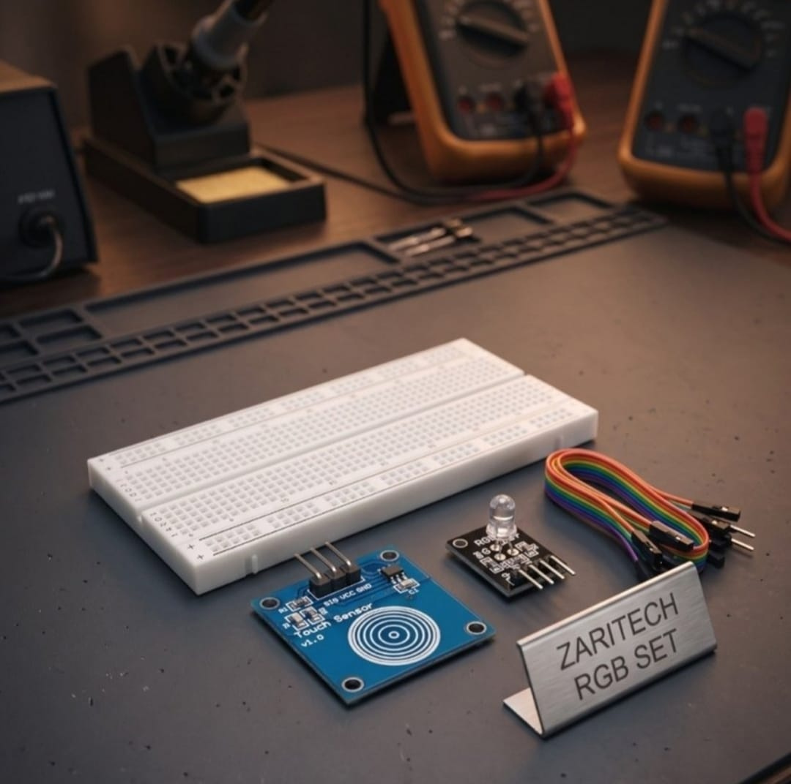

# Zaritech Capacitive Touch Interactivity & RGB Spectrum Suite 🎓

Welcome to the official repository for the **Zaritech Capacitive Touch RGB Atmosphere Set** — an interactive, hardware-level logic validation and color spectrum learning substrate engineered by **Zaritech Academy** (A division of **Zaritech Dynamics**).

### ⚙️ Educational Paradigm: Solderless HMI & Solid-State Switching
Traditional electronic input training often relies on mechanical push-buttons that suffer from debouncing noise and physical wear. This academy suite introduces students to modern **Human-Machine Interface (HMI)** design via the **HW-139 Capacitive Touch Sensor Modül**. By replacing mechanical contacts with a solid-state charge-transfer surface, developers learn how physical proximity is converted into clean digital logic levels, driving a multi-channel **RGB LED Module** to manipulate visual environmental atmospheres without computational complexity.

---

## 🛠️ Hardware & Topology Specs
Our foundational interactive engineering suite is optimized for low-latency solid-state switching, dynamic pulse routing, and clean breadboard layout tracking:

*   **Solid-State Sensory Node:** HW-139 Capacitive Touch Sensor Module utilizing a dedicated proximity detector IC for noise-free digital high/low state transitions.
*   **Visual Atmosphere Actuator:** High-Brightness RGB LED Module supporting multi-channel analog/digital pin manipulation to display targeted primary and secondary color strings.
*   **Prototyping Substrate:** 1x Premium High-Durability Large Breadboard providing an uninhibited workspace for seamless, solderless component integration.
*   **Interconnect Infrastructure:** Factory-verified premium multi-color jumper wire array optimized to maintain stable logic signals across input-output boundaries.

---

## 🗺️ Visual Architecture & Pin Topology
The fundamental hardware signal pathways, logic routing channels, and power bus distributions for this interactive system are detailed below:

### Central Interconnection Matrix

| Sub-System Node | Component Pin Name | Target Arduino Node | Operational Logic Context |
| :--- | :--- | :--- | :--- |
| **HW-139 Touch Sensor**| VCC / GND | 5V / GND | Main Logic Power Rail |
| | I/O (Signal Out) | Digital Pin 2 | Asynchronous State Interrupt Input |
| **RGB LED Module** | R (Red Cathode) | Digital Pin 9 (PWM) | Red Spectrum Intensity Control |
| | G (Green Cathode)| Digital Pin 10 (PWM)| Green Spectrum Intensity Control |
| | B (Blue Cathode) | Digital Pin 11 (PWM)| Blue Spectrum Intensity Control |

### Academic Firmware Implementation
The standalone production firmware layer orchestrating debounced touch state acquisition, dynamic color-cycling arrays, and synchronized multi-channel PWM fading outputs is isolated safely within our independent code directory.

🔗 **[Click here to view the full operational source code](./firmware/zaritech_touch_rgb.ino)**

---

## 📸 Hardware Layout

---

## 📥 Commercial Acquisition & Distribution
To purchase factory-certified **Zaritech Capacitive Touch RGB Atmosphere Sets**, secure educational institution bulk laboratory packs, or access our foundational hardware lecture notes, please contact our academic supply wing via our official [Zaritech Labs Instagram](https://instagram.com).

---

## ⚖️ License & Corporate Governance
This infrastructure is maintained under the **MIT License** and governed under the rigorous engineering frameworks of **Zaritech Dynamics**.

*May Allah grant us success on this path.*
