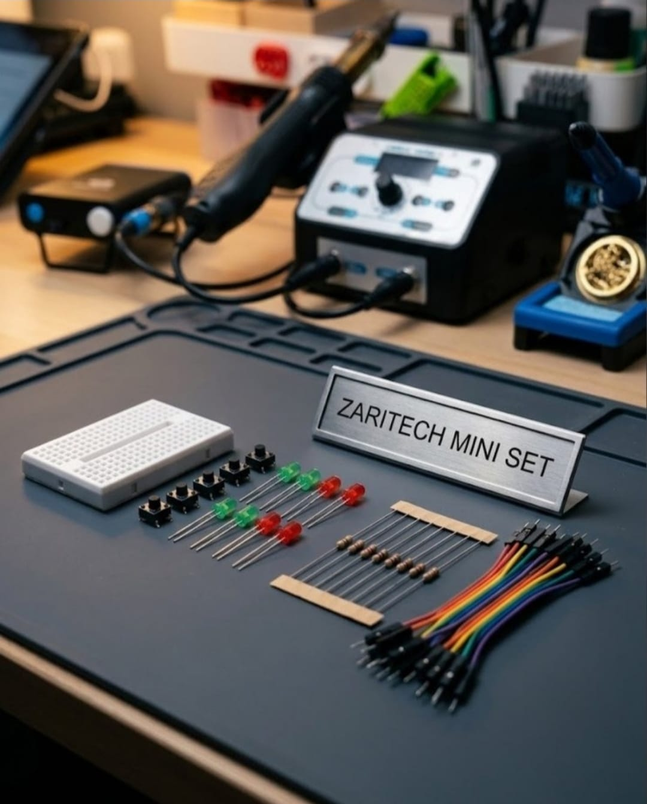

# Zaritech Fundamental GPIO Switching & Resistor Pull-Up Suite 🎓⚡

* **Academic Suite Identifier:** `KIT-03`
* **Curriculum Category:** Fundamental Electronic Switching & Passive Resistor Pull-Up Loops
* **Governance Standard:** Zaritech Dynamics Institutional Standard

Welcome to the official repository for the **Zaritech Mini Elektronik Temel Seti** — a high-reliability, developer-centric passive hardware learning substrate engineered by **Zaritech Academy** (A division of **Zaritech Dynamics**).

### ⚙️ Educational Paradigm: Hardware-Level Debounce & Current-Limiting Lojik
Before deploying complex automation algorithms on modern microcontrollers, developers must build flawless foundations in hardware-level current restriction and pull-up/pull-down switching states. This academy suite isolates these exact concepts. By deploying high-durability **Tactile Push Button Switches** alongside precision **330 Ohm Current-Limiting Resistors** on a compact mini breadboard backplane, students visually map how mechanical actuation controls discrete voltage paths to illuminate multi-color LED strings safely without triggering thermal failure modes.

---

## 🛠️ Hardware & Topology Specs
Our foundational passive engineering suite is optimized for noise-free mechanical switching loops, current dissipation tracing, and tight-footprint prototyping:

*   **Mechanical Actuation Array:** 5x Premium Tactile Push Button Switches featuring high-retention internal contacts for debounced mechanical input signaling.
*   **Visual Logic Indicator Strings:** 5x High-Efficiency Diffused LEDs (Balanced Red and Green spectrum configurations) for raw circuit-state diagnostics.
*   **Passive Protection Matrix:** 10x Precision **330 Ohm (330R) Resistors** strategically calculated to drop excess voltage, safeguard diode junctions, and act as stable pull-up/down logic anchors.
*   **Prototyping Substrate:** 1x Premium High-Durability Mini Breadboard providing a localized, solderless matrix layout for rapid signal routing.
*   **Interconnect Infrastructure:** 10-piece factory-verified premium male-to-male flexible jumper wire array engineered for zero line-resistance degradation.

---

## 🗺️ Visual Architecture & Pin Topology
The fundamental hardware signal pathways, active logic loops, and shared power rails for this educational setup are detailed inside this core matrix:

### Central Interconnection Matrix (Microcontroller IO Reference)

| Sub-System Node | Peripheral Lead Type | Target Interface Node | Operational Logic Context |
| :--- | :--- | :--- | :--- |
| **Tactile Push Switch**| Input Pole 1A | VCC Power Rail (5V) | Active Voltage Distribution Source |
| | Output Pole 1B | Digital Pin 2 (Arduino) | Pull-Down Monitored Logic Node |
| **330R Resistor** | Resistor Lead A | Output Pole 1B / Pin 2 | Input Pull-Down Stabilization Loop |
| | Resistor Lead B | Shared System Ground (GND) | Common Ground Reference Plane |
| **Visual LED Array** | LED Anode (+) | Digital Pin 13 (PWM) | Active Shifting Status Output |
| | LED Cathode (-) via 330R | Shared System Ground (GND) | Current-Limited Return Ground Path |

### Academic Firmware Implementation
The foundational software solution tracking debounced digital button matrices, execution timing counters, and responsive status LED outputs is safely isolated inside our production codebase.

🔗 **[Click here to view the full operational source code](./firmware/zaritech_mini_switching.ino)**

---

## 📸 Hardware Layout

---

## 📥 Commercial Acquisition & Distribution
To buy factory-certified **Zaritech Mini Elektronik Temel Sets**, bulk primary educational supply bundles, or institutional laboratory layout guides, please link with our logistics network via our official [Zaritech Labs Instagram](https://instagram.com).

---

## ⚖️ License & Corporate Governance
This infrastructure is maintained under the **MIT License** and governed under the rigorous engineering frameworks of **Zaritech Dynamics**.

*May Allah grant us success on this path.*
