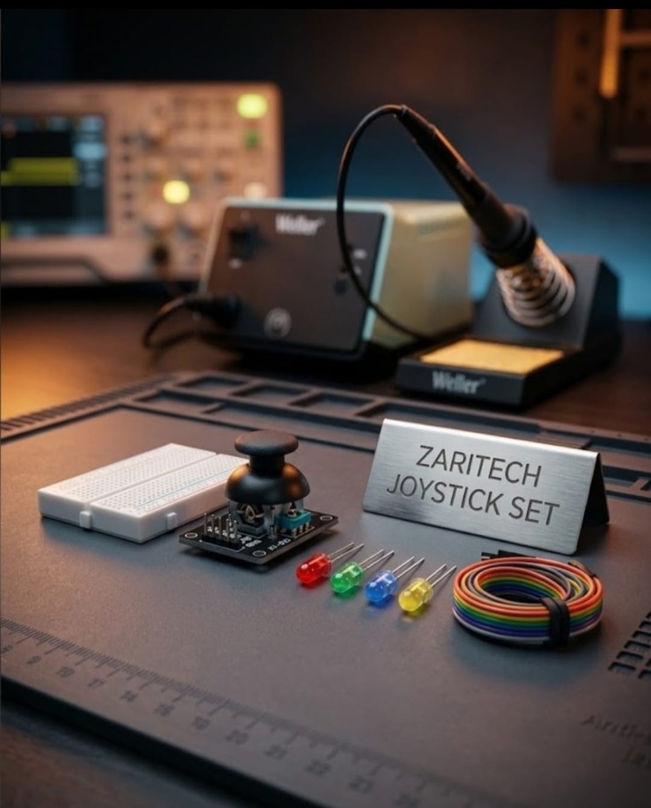

# Zaritech Multi-Axis Analog Telemetry & Vector Mapping Suite 🎓🕹️

* **Academic Suite Identifier:** `KIT-05`
* **Curriculum Category:** Multi-Axis Analog Signal Conditioning & Spatial Coordinate Mapping
* **Governance Standard:** Zaritech Dynamics Institutional Standard

Welcome to the official repository for the **Zaritech Analog Yön Kontrol Seti** — a high-efficiency hardware-level validation and human-machine interface (HMI) substrate engineered by **Zaritech Academy** (A division of **Zaritech Dynamics**).

### ⚙️ Educational Paradigm: Proportional Voltage Division & Kinematic Tracking
Before coding advanced robotic arms or autonomous drone navigations, students must master proportional control loops via analog voltage tracking. This academy suite isolates these exact concepts. By deploying the industrial-form **KY-023 Dual-Axis Joystick Module**, developers examine how mechanical angular offsets adjust dual integrated 10k potentiometer tracks. The resulting continuous voltage matrix is scanned via an external processing core to compute precise X-Y spatial vectors, flashing localized **Directional Status LED Strings** to visualize mechanical coordinate tracking in real-time.

---

## 🛠️ Hardware & Topology Specs
Our specialized proportional telemetry substrate is optimized for high-resolution dual-axis analog tracking, haptic switch registering, and tight-footprint prototyping:

*   **Dual-Axis Controller Node:** KY-023 Analog Joystick Module providing concurrent, independent X and Y coordinate tracking via internal voltage division, plus an integrated momentary push-button switch for Z-axis execution.
*   **Directional Indicator Array:** 4x High-Efficiency Diffused LEDs (Multi-color configuration representing Forward, Backward, Left, and Right axes) for physical coordinate data visualization.
*   **Prototyping Substrate:** 1x Premium High-Durability Mini Breadboard providing a localized, low-resistance hardware routing dock.
*   **Interconnect Infrastructure:** Zaritech Premium Connection Array consisting of factory-verified high-flexibility color-coded jumper lines for noise-free signal delivery.

---

## 🗺️ Visual Architecture & Pin Topology
The streamlined hardware signal pathways, active logic loops, and power bus nodes for this coordinate monitoring framework are detailed below:

### Central Interconnection Matrix (Microcontroller IO Reference)

| Sub-System Node | Component Pin Name | Target Interface Node | Operational Logic Context |
| :--- | :--- | :--- | :--- |
| **KY-023 Joystick** | +5V / GND | 5V / GND Power Rail | Main Logic Power Supply |
| | VRX (X-Axis Analog) | Analog Pin A0 | Panning/Horizontal Telemetry Stream |
| | VRY (Y-Axis Analog) | Analog Pin A1 | Tilt/Vertical Telemetry Stream |
| | SW (Z-Axis Switch) | Digital Pin 2 (Pull-Up) | Digital Mode Switch Selector |
| **Directional LEDs** | Axis Visual Pins | Digital Pins 8 / 9 / 10 / 11 | Vector Feedback Signaling Lines |

### Academic Firmware Implementation
The foundational production software pipeline executing dual-channel analog voltage sampling, mathematical coordinate filtering boundaries, and active directional LED gating is safely isolated inside our production codebase.

🔗 **[Click here to view the full operational source code](./firmware/zaritech_joystick_vector.ino)**

---

## 📸 Hardware Layout

---

## 📥 Commercial Acquisition & Distribution
To purchase factory-certified **Zaritech Analog Yön Kontrol Sets**, school robotics laboratory workshop arrays, or custom institutional tech curricula, please interface with our distribution wing via our official [Zaritech Labs Instagram](https://instagram.com).

---

## ⚖️ License & Corporate Governance
This infrastructure is maintained under the **MIT License** and governed under the rigorous engineering frameworks of **Zaritech Dynamics**.

*May Allah grant us success on this path.*
