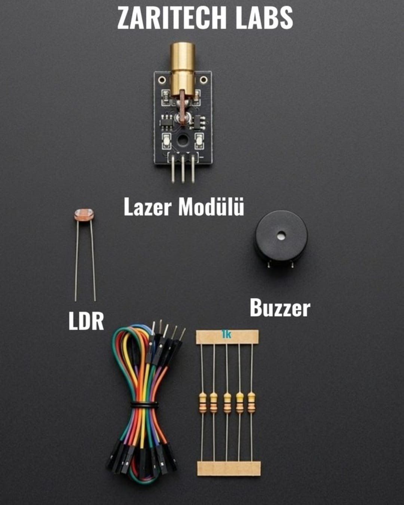

# Zaritech Photo-Electric Perimeter Defense & Optical Telemetry Suite 🎓🚨

* **Academic Suite Identifier:** `KIT-06`
* **Curriculum Category:** Optical Signal Conditioners & Photo-Electric Barrier Topologies
* **Governance Standard:** Zaritech Dynamics Institutional Standard

Welcome to the official repository for the **Zaritech Lazer Güvenlik Ağı Seti** — a high-efficiency hardware-level validation and light-dependent security infrastructure engineered by **Zaritech Academy** (A division of **Zaritech Dynamics**).

### ⚙️ Educational Paradigm: Photo-Resistive Voltage Shifting & Laser Interruption
Before managing multi-layered enterprise electronic security grids, engineering students must master photo-electric transduction and light-dependent circuit conditioning. This academy suite isolates these exact domains. By deploying a high-intensity focused **Laser Transmitter Module** aligned directly toward a precision **LDR (Light Dependent Resistor) Photocell Sensor**, students build an active optical barrier. Any physical entity crossing this localized vector causes an immediate resistance spike on the LDR substrate, altering the input voltage configuration to execute instantaneous acoustic warning telemetry via the **Active Buzzer Array**.

---

## 🛠️ Hardware & Topology Specs
Our specialized optical defense substrate is optimized for high-sensitivity photon capture, low-latency alarm trip duty-cycles, and un-tethered operational validation:

*   **Optical Transmission Engine:** 5V Focused Laser Diode Transmitter Module engineered to project a sharp, low-divergence coherent light vector across monitored spaces.
*   **Photo-Electric Sensory Node:** 5mm Premium LDR Photocell Sensor optimized for converting ambient or targeted lux values into real-time linear analog resistance matrices.
*   **Acoustic Notification Actuator:** 5V High-Resonance Active Buzzer Module for prompt localized threshold alerts and alarm signaling strings.
*   **Passive Protection Matrix:** 5x Precision **1k Ohm (1k) Resistors** calculated to establish standard pull-up or voltage divider stability structures when paired with the LDR path.
*   **Interconnect Infrastructure:** 5-piece factory-verified premium multi-color flexible jumper wire array optimized for noise-free signal delivery.

---

## 🗺️ Visual Architecture & Pin Topology
The hardware signal pathways, active analog divider loops, and power rails for this optical monitoring ecosystem are detailed below:

### Central Interconnection Matrix (Microcontroller IO Reference)

| Sub-System Node | Component Pin Name | Target Interface Node | Operational Logic Context |
| :--- | :--- | :--- | :--- |
| **Laser Module** | VCC / GND | 5V / GND Power Rail | Constant Optical Transmission Path |
| | Signal / IN | Digital Pin 7 | Software-Controlled Laser Gating |
| **LDR Sensing Loop** | Lead A (Divider Junction)| Analog Pin A0 | Continuous Photonic Telemetry Input |
| **1k Ohm Resistor** | Resistor Inline | Seated between A0 & GND | Voltage Divider Reference Ground |
| **Active Buzzer** | Positive (+) Signal | Digital Pin 12 | Acoustic Security Alarm Output |

### Academic Firmware Implementation
The foundational production software pipeline executing high-speed analog sampling, dynamic ambient lux auto-calibration, and debounced optical alert cycles is safely isolated inside our production codebase.

🔗 **[Click here to view the full operational source code](./firmware/zaritech_laser_defense.ino)**

---

## 📸 Hardware Layout

---

## 📥 Commercial Acquisition & Distribution
To purchase factory-certified **Zaritech Lazer Güvenlik Ağı Sets**, school workshop bulk packs, or to request custom security curriculum templates, please coordinate with our distribution team via our official [Zaritech Labs Instagram](https://instagram.com).

---

## ⚖️ License & Corporate Governance
This infrastructure is maintained under the **MIT License** and governed under the rigorous engineering frameworks of **Zaritech Dynamics**.

*May Allah grant us success on this path.*
