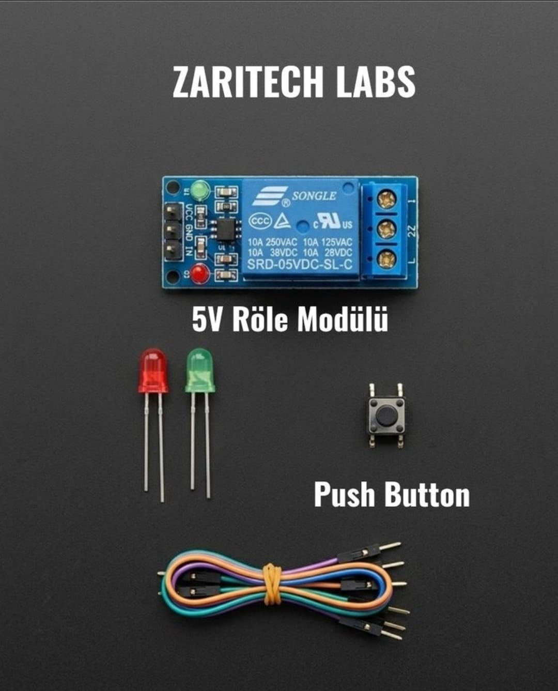

# Zaritech Isolated Load Switching & Galvanic Automation Platform 🎓⚡

* **Academic Suite Identifier:** `KIT-07`
* **Curriculum Category:** Galvanic Isolation Barriers & High-Current Actuation Control
* **Governance Standard:** Zaritech Dynamics Institutional Standard

Welcome to the official repository for the **Zaritech 5V Röle Modülü Otomasyon Seti** — a high-efficiency hardware-level validation and low-to-high voltage power switching substrate engineered by **Zaritech Academy** (A division of **Zaritech Dynamics**).

### ⚙️ Educational Paradigm: Optocoupler Protection & Inductive Relay Logic
Before interfacing embedded systems with main grid elements or high-power industrial motors, computing engineers must master the boundaries of electrical isolation. This academy suite isolates these exact concepts. By pairing a mechanical **Tactile Push Button Switch** with an opto-isolated **5V Single-Channel Relay Module**, students model safe power switching pipelines. The subsystem guides learners on how minor 5V low-current digital signals safely manipulate true grid-level currents, utilizing a **Dual Status LED Array** (Red/Green) to actively verify the physical operational states of the load contacts in real-time.

---

## 🛠️ Hardware & Topology Specs
Our specialized power automation substrate is engineered for secure high-voltage load isolation, clean current tracking, and modular smart home modeling:

*   **Load Actuation Gateway:** 5V Single-Channel Relay Module equipped with an integrated Songle electromagnetic switch supporting up to **10A (250VAC / 30VDC)** load paths, featuring onboard status LEDs and back-EMF protection.
*   **Mechanical Input Node:** 1x High-Durability Momentary Tactile Push Button Switch for manual input state triggering.
*   **Dual Visual Diagnostics:** 2x Premium Diffused LEDs (Balanced Red and Green configurations) to visually separate system standby states from active load engagement paths.
*   **Interconnect Infrastructure:** Factory-verified premium high-flexibility color-coded jumper wire array optimized to handle logic-level digital signals cleanly.

---

## 🗺️ Visual Architecture & Pin Topology
The hardware signal pathways, logic routing channels, and isolation boundaries for this power switching hub are detailed below:

### Central Interconnection Matrix (Microcontroller IO Reference)

| Sub-System Node | Component Pin Name | Target Interface Node | Operational Logic Context |
| :--- | :--- | :--- | :--- |
| **5V Relay Module** | VCC / GND | 5V / GND Power Rail | Main Control Power Supply |
| | IN (Control Input) | Digital Pin 3 | Software Active-Low Trigger Line |
| **Tactile Push Button**| Input Pole 1A | Digital Pin 2 (Pull-Up) | Monitored Manual Override Input |
| **System Safe LED** | Green Anode (+) | Digital Pin 8 | Standard Idle/Standby Visual Light |
| **Actuator Active LED**| Red Anode (+) | Digital Pin 9 | High-Voltage Load Active Warning Light |

### Academic Firmware Implementation
The foundational production software pipeline executing debounced mechanical input handling, state toggle latches, and synchronized complementary relay-LED outputs is safely isolated inside our production codebase.

🔗 **[Click here to view the full operational source code](./firmware/zaritech_relay_automation.ino)**

---

## 📸 Hardware Layout

---

## 📥 Commercial Acquisition & Distribution
To purchase factory-certified **Zaritech 5V Röle Modülü Otomasyon Sets**, secure bulk laboratory workshop kits, or comprehensive smart home educational curricula, please link with our logistics division via our official [Zaritech Labs Instagram](https://instagram.com).

---

## ⚖️ License & Corporate Governance
This infrastructure is maintained under the **MIT License** and governed under the rigorous engineering frameworks of **Zaritech Dynamics**.

*May Allah grant us success on this path.*
