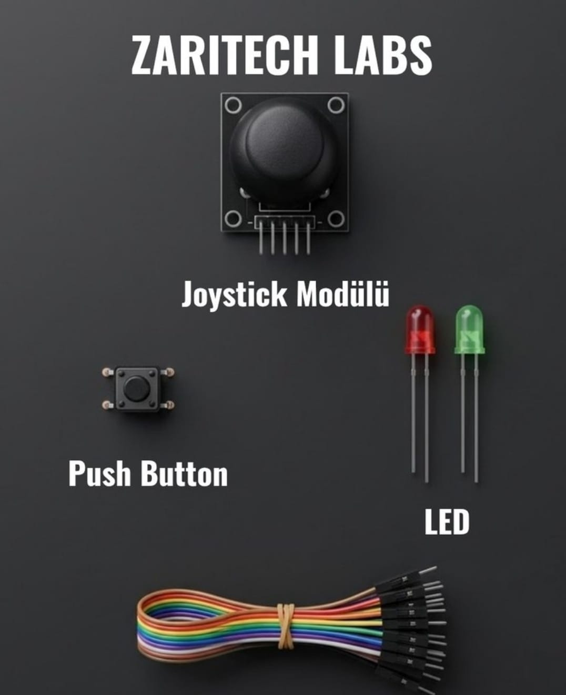

# Zaritech Kinematic Steering Array & Dual-Axis Proportional Control Platform 🎓🕹️

* **Academic Suite Identifier:** `KIT-08`
* **Curriculum Category:** Proportional Voltaric Steering Loops & Dual-Channel ADC Interfacing
* **Governance Standard:** Zaritech Dynamics Institutional Standard

Welcome to the official repository for the **Zaritech Joystick Modülü Kontrol Seti** — a high-efficiency hardware-level validation and kinematic human-machine interface (HMI) substrate engineered by **Zaritech Academy** (A division of **Zaritech Dynamics**).

### ⚙️ Educational Paradigm: Dual-Axis Geometric Tracking & Manual Overrides
Before deploying hardware routines for multi-DOF industrial robotic arms or custom wireless radio-frequency (RF) game controllers, systems engineers must understand analog coordinate scaling. This academy suite isolates these core principles. By combining a 2-axis **Analog Potentiometric Joystick Module** with an independent mechanical **Tactile Push Button Switch**, students map continuous physical angular displacements into digital numerical streams. The platform demonstrates how multi-axis proportional steering inputs control a dual-channel **Visual Diagnostic LED Array** to simulate dynamic system states and override routines in real-time.

---

## 🛠️ Hardware & Topology Specs
Our specialized robotics control substrate is optimized for precision voltage division monitoring, responsive tactile triggering, and low-noise circuit topologies:

*   **Proportional Coordinate Controller:** 1x KY-023 Dual-Axis Analog Joystick Module providing concurrent independent X (Pan) and Y (Tilt) telemetry data via internal 10k mechanical resistor sweeps, featuring a secondary integrated Z-axis click switch.
*   **Mechanical Override Trigger:** 1x High-Durability Momentary Push Button Switch for structural calibration, system mode cycling, or emergency stop (E-Stop) simulations.
*   **Dual-Channel Indicator Array:** 2x Premium Diffused LEDs (Balanced Red and Green configurations) calibrated to physically verify binary directional boundaries or active threshold alerts.
*   **Interconnect Infrastructure:** Factory-verified premium multi-color flexible jumper wire bundle optimized to route analog signal streams without structural attenuation.

---

## 🗺️ Visual Architecture & Pin Topology
The hardware signal pathways, shared voltage buses, and operational input-output mapping grids are detailed below:

### Central Interconnection Matrix (Microcontroller IO Reference)

| Sub-System Node | Component Pin Name | Target Interface Node | Operational Logic Context |
| :--- | :--- | :--- | :--- |
| **Joystick Module** | VCC / GND | 5V / GND Power Rail | Primary Potentiometer Power Track |
| | VRX (X-Axis Analog) | Analog Pin A0 | Panning / Horizontal Voltaric Telemetry |
| | VRY (Y-Axis Analog) | Analog Pin A1 | Tilting / Vertical Voltaric Telemetry |
| **Tactile Push Switch**| Input Pole 1A | Digital Pin 2 (Pull-Up) | External Manual Override Input Node |
| **Status Indicator 1** | Green Anode (+) | Digital Pin 8 | Positive Axis Vector Feedback Light |
| **Status Indicator 2** | Red Anode (+) | Digital Pin 9 | Negative Axis Vector / Alert Light |

### Academic Firmware Implementation
The foundational production software pipeline executing precise dual-channel ADC filtering routines, multi-state button debounce handling, and responsive coordinate validation gating is safely isolated inside our production codebase.

🔗 **[Click here to view the full operational source code](./firmware/zaritech_kinematic_joystick.ino)**

---

## 📸 Hardware Layout

---

## 📥 Commercial Acquisition & Distribution
To purchase factory-certified **Zaritech Joystick Modülü Kontrol Sets**, corporate institutional bulk learning arrays, or validated academic robotics textbooks, please coordinate with our supply logistics channel via our official [Zaritech Labs Instagram](https://instagram.com).

---

## ⚖️ License & Corporate Governance
This infrastructure is maintained under the **MIT License** and governed under the rigorous engineering frameworks of **Zaritech Dynamics**.

*May Allah grant us success on this path.*
