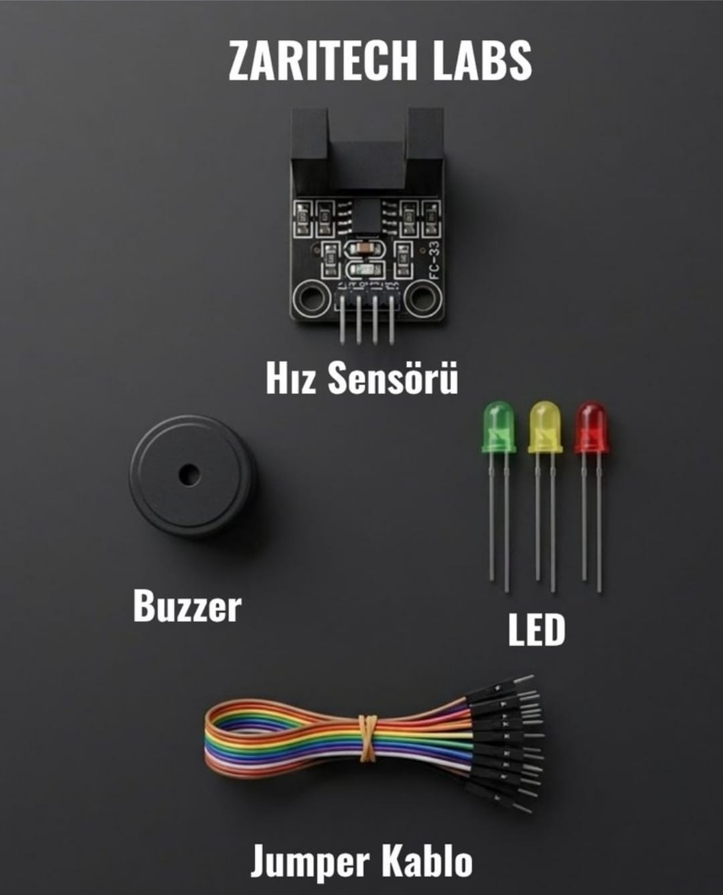

# Zaritech Infrared Slotted Velocity Encoder & Rotary Frequency Telemetry 🎓🏎️

* **Academic Suite Identifier:** `KIT-09`
* **Curriculum Category:** Optical Tachometry, Asynchronous Pulse Interrupts & Visual RPM Indication
* **Governance Standard:** Zaritech Dynamics Institutional Standard

Welcome to the official repository for the **Zaritech Kızılötesi Hız Sensörü Seti** — a high-precision hardware-level velocity validation and rotary telemetry substrate engineered by **Zaritech Academy** (A division of **Zaritech Dynamics**).

### ⚙️ Educational Paradigm: Asynchronous Opto-Interrupter Logic & RPM Tracking
In autonomous vehicle development, relying on blind motor drive voltage configurations leads to major drift errors and positioning failures. This academy suite introduces students to advanced closed-loop velocity validation using the **FC-33 Infrared Slotted Velocity Encoder Subsystem**. By measuring the frequency of light-beam disruptions caused by a mechanical encoder wheel slotting through the integrated phototransistor, students learn the principles of hardware-level **Asynchronous Pulse Interrupt Handling**. The node evaluates exact time-deltas to scale raw frequency arrays into meaningful RPM structures, utilizing a **Tiered Multi-Color LED Array** (Green/Yellow/Red) and an **Active Acoustic Buzzer** to output real-time visual and auditory over-speed alarms.

---

## 🛠️ Hardware & Topology Specs
Our mission-critical velocity telemetry substrate is optimized for high-speed edge transition parsing, debounced interrupt routines, and modular tachometer configurations:

*   **Rotary Sensor Node:** FC-33 Slotted Infrared Opto-Interrupter Module generating high-speed digital transitions (TTL Logic levels) on a dedicated output pin during light-path interruptions.
*   **Acoustic Threshold Actuator:** 5V High-Resonance Active Buzzer Module programmed to sound instantaneous alarms during sudden over-speed profiles or critical system locks.
*   **Tiered Visual Dashboard:** 3x Premium Diffused Status LEDs (Green, Yellow, Red) structured as a physical digital tachometer layout for multi-level velocity zoning.
*   **Interconnect Infrastructure:** Factory-verified premium high-flexibility color-coded jumper wire array calibrated for noise-free signal delivery under high interrupt frequencies.

---

## 🗺️ Visual Architecture & Pin Topology
The streamlined hardware signal pathways, shared power lines, and digital interrupt registers for this optical tracking system are detailed below:

### Central Interconnection Matrix (Microcontroller IO Reference)

| Sub-System Node | Component Pin Name | Target Interface Node | Operational Logic Context |
| :--- | :--- | :--- | :--- |
| **Infrared Encoder**| VCC / GND | 5V / GND Power Rail | Sensor Core Main Logic Power |
| | OUT (Digital Pulse)| Digital Pin 2 (Hardware Interrupt 0) | High-Speed Pulse Edge Detection Input |
| **Acoustic Buzzer** | Positive (+) Signal | Digital Pin 12 | Critical Velocity Overrun Trigger |
| **Safe Zone Light** | Green Anode (+) | Digital Pin 8 | Nominal Nominal Angular Speed Display |
| **Warning Light**   | Yellow Anode (+) | Digital Pin 9 | Escalating Operational Velocity Alert |
| **Critical Alarm**  | Red Anode (+) | Digital Pin 10 | Dangerous Over-Speed Barrier Indicator |

### Academic Firmware Implementation
The foundational production software pipeline executing precise timer registers, non-blocking hardware interrupt routines, and tiered frequency boundary calculations is safely isolated inside our production codebase.

🔗 **[Click here to view the full operational source code](./firmware/zaritech_velocity_encoder.ino)**

---

## 📸 Hardware Layout

---

## 📥 Commercial Acquisition & Distribution
To purchase factory-certified **Zaritech Kızılötesi Hız Sensörü Sets**, secure educational institution workshop arrays, or specialized automotive simulation curricula, please coordinate with our supply logistics channel via our official [Zaritech Labs Instagram](https://instagram.com).

---

## ⚖️ License & Corporate Governance
This infrastructure is maintained under the **MIT License** and governed under the rigorous engineering frameworks of **Zaritech Dynamics**.

*May Allah grant us success on this path.*
