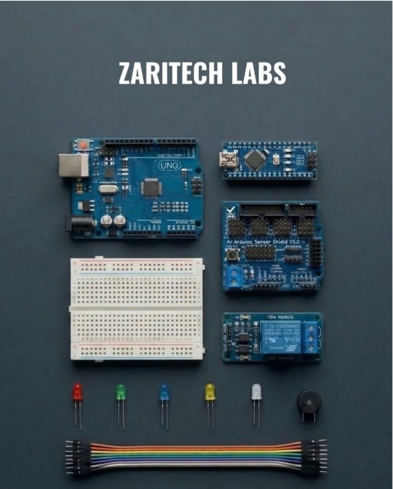

# Zaritech Dual-MCU Prototyping & Sensor Shield Infrastructure 🎓⚡

* **Academic Suite Identifier:** `KIT-10`
* **Curriculum Category:** Multi-Form-Factor MCU Interfacing, Dedicated Sensor Backplanes & Power Distribution
* **Governance Standard:** Zaritech Dynamics Institutional Standard

Welcome to the official repository for the **Zaritech Gelişmiş Arduino Geliştirme Kompleksi** — a high-performance cross-compilation and advanced sensory signal routing architecture engineered by **Zaritech Academy** (A division of **Zaritech Dynamics**).

### ⚙️ Educational Paradigm: Hardware Cross-Scaling & Dedicated Backplane Routing
In heterogeneous embedded software development, engineers must transition applications fluidly across varying physical form-factors. This academy suite addresses this exact multi-scale challenge. By providing a synchronized **Dual-MCU Cross-Compilation Substrate** (combining the standard layout Arduino Uno R3 and the space-constrained, breadboard-native Arduino Nano V3), students master the concepts of identical register maps deployed on completely diverse geometric footprints. Furthermore, the incorporation of the **Arduino Sensor Shield V5.0 Backplane Matrix** teaches students how to eliminate floating signal grounds, isolate power surges, and route up to over a dozen peripherals concurrently without wiring clutter.

---

## 🛠️ Hardware & Topology Specs
Our advanced dual-architecture prototyping system is optimized for high-density sensor branching, galvanic signal isolation, and clean logic path distribution:

*   **Standard Form-Factor Computing Node:** Arduino Uno R3 prototyping platform running on the robust 8-bit ATmega328P SMD system architecture.
*   **Micro Form-Factor Computing Node:** Arduino Nano V3 ultra-compact layout featuring integrated hardware serial routing pipelines, specifically tailored for tight physical enclosures and high-density breadboard array docking.
*   **Dedicated Sensor Backplane:** Arduino Sensor Shield V5.0 expansion grid converting traditional single IO headers into dedicated **VCC-GND-Signal (SVG) Triple-Lane Rows**, featuring I2C hardware bus breakouts, APC220 telemetry tracks, and external power screw terminals.
*   **Isolation Actuator Layer:** 5V Single-Channel Relay Module supporting true **10A (250VAC / 30VDC)** power grid modulation.
*   **Auditory Alert Unit:** 5V High-Resonance Active Buzzer Module for immediate haptic alarm output strings.
*   **Visual Status Matrix:** 5x Multi-Color Diffused LEDs acting as a comprehensive hardware diagnostic dashboard loop.
*   **Interconnect Substrate Array:** 1x Premium High-Durability Medium Breadboard combined with a full 40-piece high-durability color-coded jumper matrix path.

---

## 🗺️ Visual Architecture & Pin Topology
The streamlined hardware signal pathways, shared bus expansions, and multi-MCU IO reference maps are detailed below:

### Central Backplane Interconnection Matrix (Sensor Shield V5.0 Mapping)

| Shield Expansion Port | Component Target Pin | Primary MCU GPIO Node | Operational Logic Domain |
| :--- | :--- | :--- | :--- |
| **Digital SVG Block D2** | Manual Trigger Switch | Digital Pin 2 (Interrupt 0) | System Latch Interrupt Sequence |
| **Digital SVG Block D3** | Relay Actuator Input (IN) | Digital Pin 3 (PWM) | Isolated Power Grid Modulation |
| **Digital SVG Block D12**| Active Buzzer Terminal | Digital Pin 12 | Haptic Acoustic Diagnostic Warning |
| **Digital SVG Block D8** | Indicator LED (Green) | Digital Pin 8 | Baseline Safe Execution Light |
| **I2C Header Block** | External Telemetry Bus | SDA (A4) / SCL (A5) | Continuous Multi-Drop Data Bus |

### Academic Firmware Implementation
The foundational production software pipeline executing debounced multi-state digital inputs, asynchronous buzzer tone modulations, and synchronized high-current relay latch loops is safely isolated inside our production codebase.

🔗 **[Click here to view the full operational source code](./firmware/zaritech_shield_infrastructure.ino)**

---

## 📸 Hardware Layout

---

## 📥 Commercial Acquisition & Distribution
To purchase factory-certified **Zaritech Gelişmiş Arduino Geliştirme Kompleksi Sets**, secure school laboratory workshop bundle supplies, or specialized advanced embedded firmware lecture guides, please link with our logistics division via our official [Zaritech Labs Instagram](https://instagram.com).

---

## ⚖️ License & Corporate Governance
This infrastructure is maintained under the **MIT License** and governed under the rigorous engineering frameworks of **Zaritech Dynamics**.

*May Allah grant us success on this path.*
