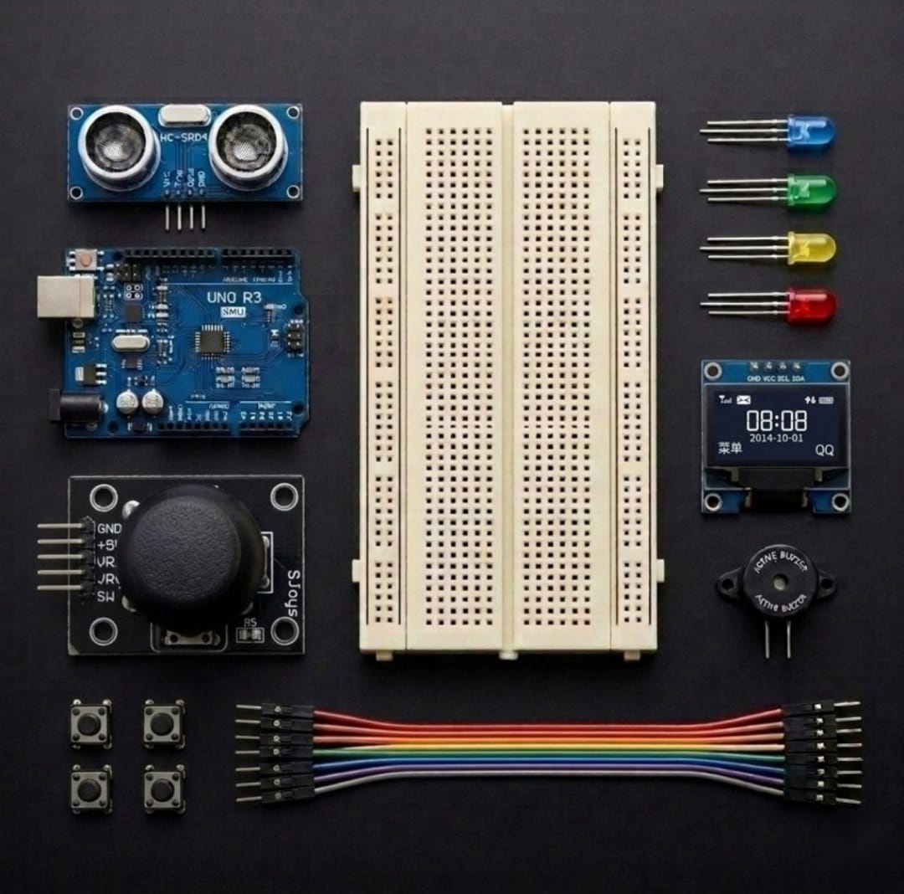

# Zaritech Spatial Proximity Mapping & Interactive OLED UI Substrate 🎓🕹️

* **Academic Suite Identifier:** `KIT-11`
* **Curriculum Category:** Graphic Display Arabellekleme (Frame-Buffering), Sonik Uçuş Zamanı Analizi & HMI Menü Yapıları
* **Governance Standard:** Zaritech Dynamics Institutional Standard

Welcome to the official repository for the **Zaritech Özel Geliştirme Seti** — a high-performance spatial validation, interactive graphical interface, and multi-sensor navigation engine engineered by **Zaritech Academy** (A division of **Zaritech Dynamics**).

### ⚙️ Educational Paradigm: Asynchronous Graphical Frame-Buffering & Sonic Radar Loops
Modern spatial computing requires deep expertise in non-blocking graphical renders paired with continuous telemetry feeds. This academy suite addresses this challenge by replacing outdated high-wire-count character LCDs with a sleek, 4-pin **I2C OLED Display System**. Students develop algorithms for **Time-of-Flight Spatial Metric Parsing** using the **HC-SR04 Ultrasonic Distance Module**, translating raw echo delays into metric distance tracking. By mapping a **Dual-Axis Analog Joystick Matrix** alongside tactile push switches, learners design custom nested GUI menus, rendering responsive progress bars and managing real-time acoustic danger warnings via the integrated **Active Buzzer System**.

---

## 🛠️ Hardware & Topology Specs
Our mission-critical spatial monitoring complex is optimized for high-resolution I2C bus streams, low-latency telemetry updates, and dynamic solid-state menus:

*   **Core Wireless-Ready Substrate:** Arduino Uno R3 development engine driving low-profile 8-bit ATmega328P SMD computing processes.
*   **Visual Interface Display Unit:** 0.96-inch High-Contrast I2C OLED Screen (SSD1306 Hardware Layout) calibrated for asynchronous multi-tier graphics buffering.
*   **Spatial Telemetry Node:** HC-SR04 Ultrasonic Distance Sensor evaluating precision non-contact sonic pulse time-of-flight boundaries.
*   **HMI Analog Vector Input:** KY-023 Dual-Axis Joystick Module with continuous potentiometric panning/tilting registers and an integrated Z-axis selection key.
*   **Auditory Alert Actuator:** 5V High-Resonance Active Buzzer Node providing discrete acoustic threshold tones and parking sensor alarm clicks.
*   **Visual Status Matrix:** 4x Premium Diffused LEDs (Red, Yellow, Green, Blue cascade strings) for immediate visual spatial mapping zones.
*   **Prototyping Infrastructure:** 1x Rugged 400-Pin Medium Breadboard combined with a factory-verified flexible jumper interconnect array.
*   **Tactile Input String:** 4x Momentary High-Durability Push Button Switches for discrete parameter manipulation and menu bypass loops.

---

## 🗺️ Visual Architecture & Pin Topology
The streamlined hardware signal pathways, shared I2C telemetry lines, and system GPIO mappings are detailed below:

### Central Interconnection Matrix (I2C Bus & Pin Mapping)

| Peripheral Module | Component Pin Name | Target Interface Node | Operational Logic Context |
| :--- | :--- | :--- | :--- |
| **I2C OLED Display** | SDA / SCL | Analog Pins A4 / A5 | Shared High-Speed Local Data Bus |
| **HC-SR04 Sensor** | Trigger Pin | Digital Pin 5 | Sonic Wave Pulse Emitter |
| | Echo Pin | Digital Pin 6 | Time-of-Flight Logic Return Input |
| **Analog Joystick** | VRX / VRY | Analog Pins A0 / A1 | Coordinate Steering Tracking Voltages |
| **Active Buzzer** | Positive (+) Signal | Digital Pin 12 | Acoustic Threshold Warning Emitter |
| **Visual LED Array** | Green / Yellow / Red | Digital Pins 8 / 9 / 10 | Tiered Proximity Safe/Alert Lights |

### Academic Firmware Implementation
The full, modular production software pipeline executing non-blocking OLED canvas prints, ultrasonic distance filters, and raw analog joystick vector parsers is safely isolated inside our production codebase.

🔗 **[Click here to view the full operational source code](./firmware/zaritech_spatial_ui.ino)**

---

## 📸 Hardware Layout

---

## 📥 Commercial Acquisition & Distribution
To purchase factory-certified **Zaritech Özel Geliştirme Sets**, institutional coding workshop bundles, or custom secondary technical education curricula, please connect with our academic distribution pipeline via our official [Zaritech Labs Instagram](https://instagram.com).

---

## ⚖️ License & Corporate Governance
This infrastructure is maintained under the **MIT License** and governed under the rigorous engineering frameworks of **Zaritech Dynamics**.

*May Allah grant us success on this path.*
