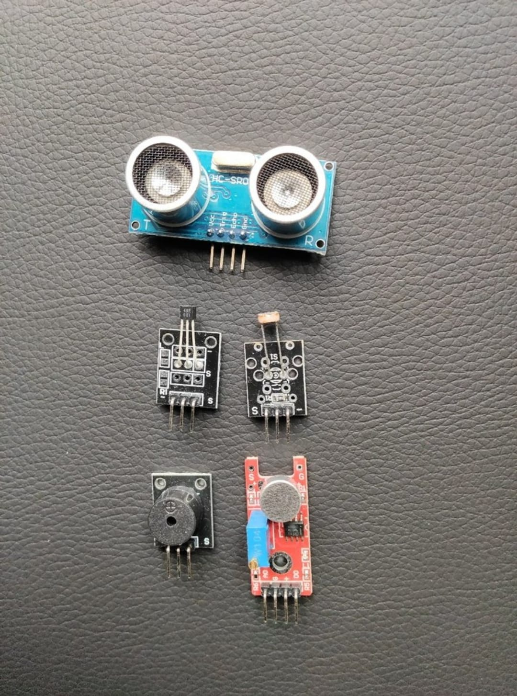

# Zaritech Heterogeneous Sensor Fusion & Multi-Domain Diagnostic Suite 🎓🔬

* **Academic Suite Identifier:** `KIT-13`
* **Curriculum Category:** Heterogeneous Sensor Fusion, Multi-Domain Data Streams & Cross-Platform Interfacing
* **Governance Standard:** Zaritech Dynamics Institutional Standard

Welcome to the official repository for the **Zaritech 5 Temel Sensör Modül Seti** — a high-performance cross-platform sensory validation, diagnostic signal processing, and multi-domain environmental tracking ecosystem engineered by **Zaritech Academy** (A division of **Zaritech Dynamics**).

### ⚙️ Educational Paradigm: Heterogeneous Sensory Input Strips & Cross-Platform Scaling
Modern automation and autonomous systems do not scale on a single sensor type. Engineers must develop advanced architectures capable of handling **Cross-Domain Environmental Telemetry** concurrently. This academy suite addresses this integration bottleneck. By establishing independent **Heterogeneous Sensory Input Strips** that capture sound pressure waves (Microphone Module), optical lux fluxes (LDR Array), spatial distances (HC-SR04 Sonar), and magnetic flux polarities (Hall Effect Switch), students master multi-variable algorithm building, data filtering, and synchronized physical alerting loops via the **Active Buzzer Output Subsystem**.

---

## 🛠️ Hardware & Topology Specs
Our mission-critical sensor validation complex is optimized for wide cross-platform compatibility (Arduino, STM32, ESP32, ESP8266, Raspberry Pi), noise-free shared bus tracks, and low-latency digital/analog signal paths:

*   **Spatial Proximity Node:** HC-SR04 Ultrasonic Distance Sensor utilizing precise non-contact sonic pulse time-of-flight reflections for localized spatial metrics.
*   **Magnetic Flux Selector:** 3144-Series Hall Effect Magnetic Sensor Module evaluating proximity changes in localized magnetic lines and polarity thresholds.
*   **Optical Lux Telemetry Node:** Calibrated LDR (Light Dependent Resistor) Sensor Module providing robust digital/analog mapping transitions based on spatial luminance arrays.
*   **Acoustic Wave Receptor:** High-Sensitivity Microphone Sound Sensor Module equipped with an onboard operational amplifier comparator for debounced audio threshold triggering.
*   **Acoustic Signal Unit:** 5V High-Resonance Active Buzzer Module for prompt localized threshold alerts and alarm signaling strings.
*   **Interconnect Substrate Array:** High-durability factory-verified premium multi-color flexible jumper matrix path for secure signal paths across the entire grid.

---

## 🗺️ Visual Architecture & Pin Topology
The streamlined hardware signal pathways, shared bus lines, and output triggers for this multi-domain ecosystem are detailed below:

### Central Master Interconnection Matrix (Microcontroller IO Reference)

| Peripheral Module | Component Pin Name | Target Interface Node | Operational Logic Domain |
| :--- | :--- | :--- | :--- |
| **HC-SR04 Sonar** | Trigger / Echo | Digital Pins D5 / D6 | Sonic Proximity Telemetry Input |
| **Hall Effect Sensor**| Digital Output (DO) | Digital Pin D2 (Interrupt 0) | Magnetic Field Boundary Trigger |
| **LDR Sensor Module** | Analog Output (AO) | Analog Pin A0 | Ambient Light Gradient Level Track |
| **Sound Sensor Core** | Digital Output (DO) | Digital Pin D3 (Interrupt 1) | Acoustic Wave Inbound Interruption |
| **Active Buzzer Alert**| Positive (+) Signal | Digital Pin D12 | Universal Subsystem Alarm Output |

### Academic Firmware Implementation
The full, modular multi-layered firmware solution executing asynchronous sensor scanning arrays, multi-channel threshold gating, and localized alarm routines is safely isolated within our production codebase.

🔗 **[Click here to view the full operational source code](./firmware/zaritech_sensor_fusion_suite.ino)**

---

## 📸 Hardware Layout

---

## 📥 Commercial Acquisition & Distribution
To purchase factory-certified **Zaritech 5 Temel Sensör Modül Sets**, wholesale institutional laboratory supply packs, or multi-platform firmware integration templates, please synchronize with our distribution team via our official [Zaritech Labs Instagram](https://instagram.com).

---

## ⚖️ License & Corporate Governance
This infrastructure is maintained under the **MIT License** and governed under the rigorous engineering frameworks of **Zaritech Dynamics**.

*May Allah grant us success on this path.*
