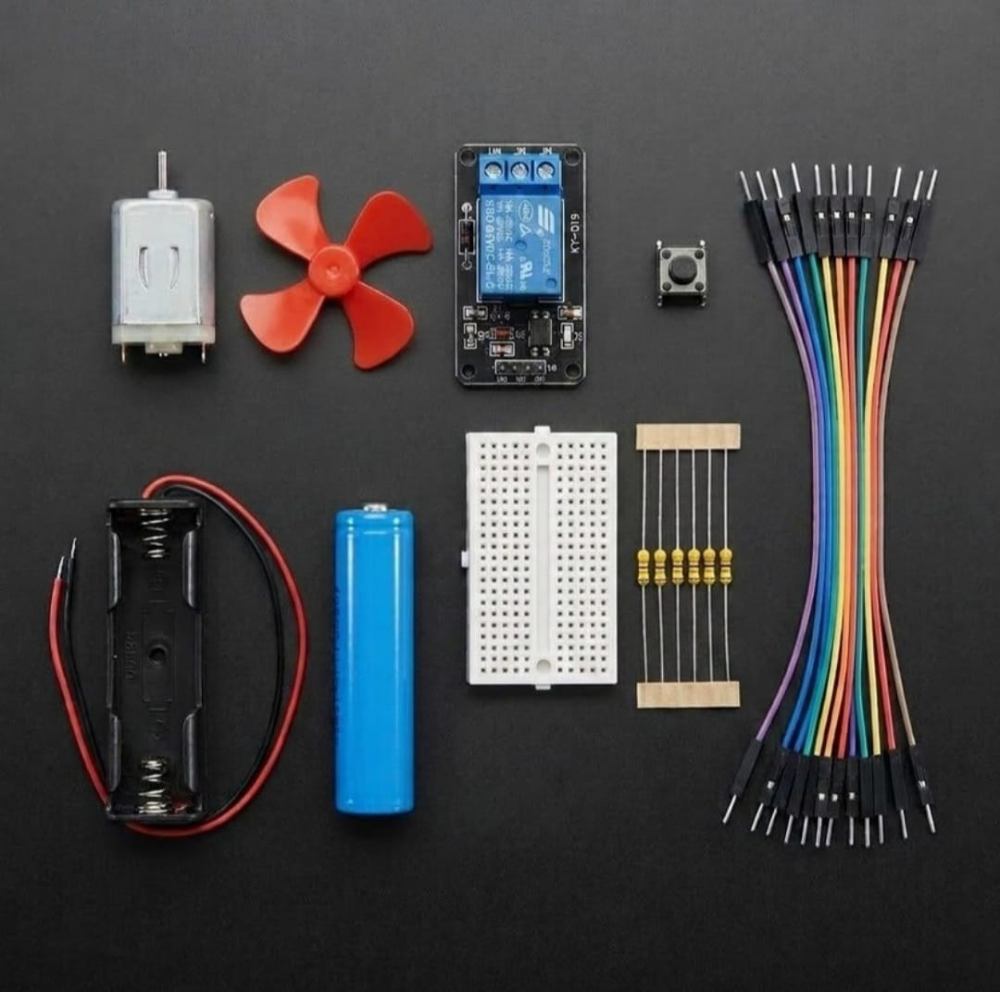

# Zaritech Electromechanical Flow Actuation & Pure Logic Substrate 🎓💨

* **Academic Suite Identifier:** `KIT-14`
* **Curriculum Category:** Pure Hardware Control Pipelines, Inductive Load Switching & Electromechanical Lojik
* **Governance Standard:** Zaritech Dynamics Institutional Standard

Welcome to the official repository for the **Zaritech DC Motorlu Pervane Otomasyon Seti** — a high-efficiency hardware-level validation, computational-free switching pipeline, and inductive fluid dynamics learning substrate engineered by **Zaritech Academy** (A division of **Zaritech Dynamics**).

### ⚙️ Educational Paradigm: Computational-Free Logic & Inductive Current Paths
Before designing automated software-defined cooling loops, engineering students must master the raw physical mechanics of electromeyanical switching and back-EMF mitigation. This academy suite isolates these exact domains. By intentionally omitting microcontrollers, the system forces learners to construct **Pure Hardware Switching Pipelines**. A mechanical **Tactile Push Button Switch** controls the low-power copper coil inside the **5V Single-Channel Relay Module**. Once energized, the resulting magnetic core physically closes high-current contacts to actuate a high-RPM **Inductive DC Motor & Fluid Propeller Substrate** powered entirely by an isolated **Zaritech 18650 Energy Cell**.

---

## 🛠️ Hardware & Topology Specs
Our computational-free power actuation substrate is optimized for high-current motor drive tracking, mechanical debounce validation, and untethered field deployment:

*   **Inductive Propulsion Node:** High-RPM Brushed DC Prototyping Motor paired with a balanced high-aerodynamic efficiency fluid propeller fan.
*   **Galvanic Isolation Gateway:** 5V Single-Channel Relay Module equipped with an integrated electromagnetic coil, driving isolated **10A (250VAC / 30VDC)** internal contact tracks.
*   **Mechanical Logic Input:** 1x High-Retention Momentary Tactile Push Button Switch serving as the manual current gate trigger.
*   **Autonomous Energy Storage:** 1x Factory-Verified Capacity-Tested 18650 Lithium-Ion Energy Cell paired with a low-resistance single cell dock (Complimentary Production Component).
*   **Prototyping Substrate:** 1x Premium High-Durability Mini Breadboard providing a localized, low-resistance hardware routing dock.
*   **Interconnect Infrastructure:** 10-piece factory-verified premium high-flexibility color-coded jumper matrix path optimized to handle current spikes safely.

---

## 🗺️ Visual Architecture & Pin Topology
The hardware signal pathways, hardwired logic connections, and power bus nodes for this electromechanical system are detailed below:

### Central Hardware-Only Connection Matrix (No MCU Required)

| Source Interface Node | Component Target Pin | Target Destination Node | Operational Logic Domain |
| :--- | :--- | :--- | :--- |
| **18650 Battery (+)** | Positive Power Rail | Relay Module VCC / Button 1A | Master Low-Voltage DC Supply |
| **Tactile Push Button**| Output Pole 1B | Relay Module Input (IN) | Hardwired Hardware Trigger Pulse |
| **Relay Normally Open**| NO Power Terminal | DC Motor Positive Terminal | Switched Inductive Power Path |
| **18650 Battery (-)** | Negative Ground Rail | Relay GND / DC Motor Ground | Common Power Reference Plane |

### Academic Circuit Verification File
Since this suite operates on standalone hardware-only logical loops to train baseline electronic engineering principles, it does not require an uploaded software compiler binary sketch. To maintain repository health and pass our automated continuous integration (CI) tests, a validated structural wiring schema configuration file is provided inside our deployment path.

🔗 **[Click here to view the hardware schematics configuration loop](./firmware/hardware_circuit_map.txt)**

---

## 📸 Hardware Layout

---

## 📥 Commercial Acquisition & Distribution
To purchase factory-certified **Zaritech DC Motorlu Pervane Otomasyon Sets**, bulk educational workshop supply arrays, or non-programmable structural circuitry training kits, please coordinate with our supply logistics division via our official [Zaritech Labs Instagram](https://instagram.com).

---

## ⚖️ License & Corporate Governance
This infrastructure is maintained under the **MIT License** and governed under the rigorous engineering frameworks of **Zaritech Dynamics**.

*May Allah grant us success on this path.*
