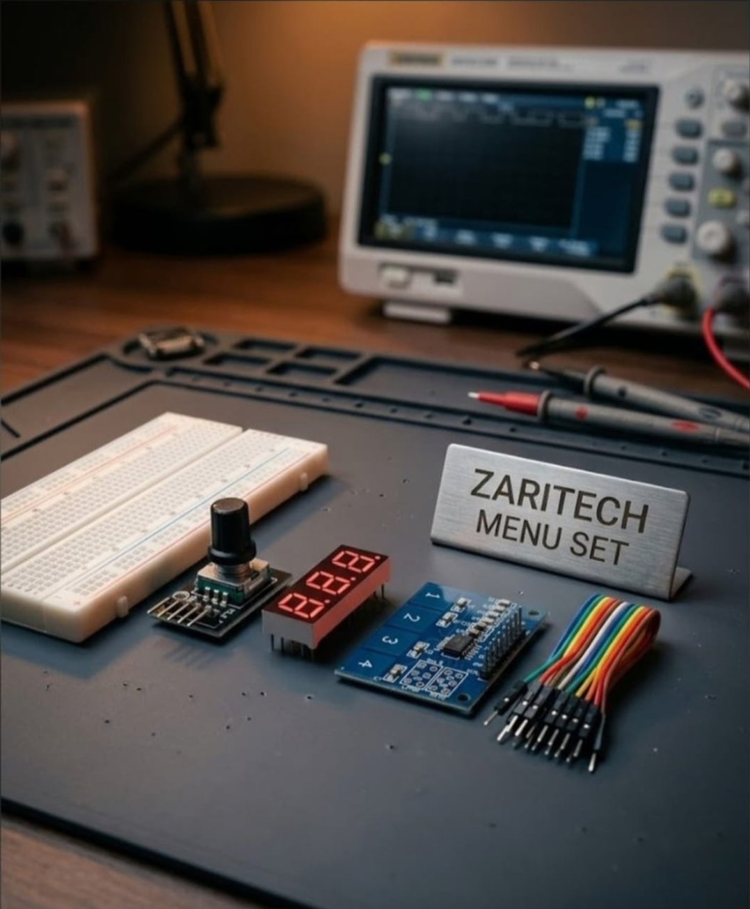

# Zaritech Industrial HMI Menu Topology & Segment Multiplexing Substrate 🎓📊

* **Academic Suite Identifier:** `KIT-15`
* **Curriculum Category:** Asynchronous Segment Multiplexing, Quadrature Input Buffering & Solid-State HMI Design
* **Governance Standard:** Zaritech Dynamics Institutional Standard

Welcome to the official repository for the **Zaritech Akıllı Menü ve Gösterge Seti** — a high-reliability Human-Machine Interface (HMI), multi-digit dynamic display telemetry, and touch-actuated data entry environment engineered by **Zaritech Academy** (A division of **Zaritech Dynamics**).

### ⚙️ Educational Paradigm: Synchronized Visual Multiplexing & Haptic Data Entry
In the validation of professional measurement hardware and automation panels, user experience demands single-point haptic navigation paired with continuous numeric feedback. This academy suite addresses this exact domain. By orchestrating a high-durability 360-degree **Rotary Encoder Subsystem** alongside a **3-Digit 7-Segment Common Anode Display Array**, students master the principles of high-speed **Asynchronous Segment Multiplexing**. Users smoothly browse nested logic arrays, calibrate numerical parameters, and commit inputs using a wear-free **Solid-State 4-Channel Touch Keypad Substrate**, visually outputting status variables instantly without structural computation lags.

---

## 🛠️ Hardware & Topology Specs
Our mission-critical HMI development complex is optimized for low-latency digital matrix scanning, high-refresh multiplexed visual grids, and clean lab prototyping:

*   **Haptic Control Emitter:** 1x Rugged Rotary Encoder Module with distinct detent feedback, dedicated quadrature (CLK/DT) outputs, an integrated momentary select switch (SW), and a premium deep-profile control knob.
*   **Visual Telemetry Grid:** 3-Digit 7-Segment Common Anode Display Array for sharp, high-luminance numeric tracking and parameter menu index visualization.
*   **Solid-State Input Matrix:** TTP224-based 4-Channel Capacitive Touch Keypad Module for low-latency digital mode selections and cryptographic token entry.
*   **Prototyping Substrate:** 1x Premium High-Durability Large Breadboard (830 Tie-Points Layout) providing absolute mechanical and electrical stability.
*   **Interconnect Infrastructure:** Zaritech Premium Connection Array consisting of factory-verified high-flexibility color-coded jumper matrix runs.

---

## 🗺️ Visual Architecture & Pin Topology
The streamlined hardware signal pathways, shared multiplex lines, and input-output registers for this advanced HMI complex are logged below:

### Central Interconnection Matrix (Microcontroller IO Reference)

| Sub-System Node | Component Pin Name | Target Interface Node | Operational Logic Context |
| :--- | :--- | :--- | :--- |
| **Rotary Encoder** | CLK / DT | Digital Pins D2 / D3 | Quadrature Interrupt Inputs (A/B) |
| | SW (Push Switch) | Digital Pin D4 | Menu Parameter Selection Commit |
| **Touch Keypad** | OUT1 - OUT4 | Digital Pins D5 / D6 / D7 / D8 | Discrete Touch Matrix Input Channels |
| **3-Digit Display** | Segment Pins (A-G) | Digital Pins D9 to D15 | Shared Multiplexed Data Line Bus |
| | Digit Select (1-3) | Analog Pins A0 / A1 / A2 | Common Anode High-Side Gating Pins |

### Academic Firmware Implementation
The full, multi-layered firmware solution executing digital quadrature tracking, non-blocking visual multiplexing sweep arrays, and debounced touch pad interrupt handling is safely isolated within our production codebase.

🔗 **[Click here to view the full operational source code](./firmware/zaritech_hmi_segment_menu.ino)**

---

## 📸 Hardware Layout

---

## 📥 Commercial Acquisition & Distribution
To purchase factory-certified **Zaritech Akıllı Menü ve Gösterge Sets**, secure technical laboratory bulk arrays, or custom instrumentation curriculum guides, please interface with our distribution framework via our official [Zaritech Labs Instagram](https://instagram.com).

---

## ⚖️ License & Corporate Governance
This infrastructure is maintained under the **MIT License** and governed under the rigorous engineering frameworks of **Zaritech Dynamics**.

*May Allah grant us success on this path.*
